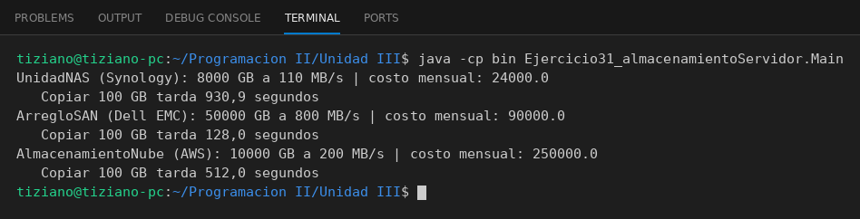

# AlmacenamientoServidor

Programación II - Unidad 3 - Ejercicio 31

## Consigna
Modelar una jerarquía de clases con herencia: una clase base y subclases que reutilizan código con `super` y sobrescriben métodos. Almacenamiento de servidores.

## Lógica
- Base con capacidad, tasa de transferencia y proveedor (`protected`).
- `UnidadNAS`, `ArregloSAN` y `AlmacenamientoNube` usan `super(...)` y reescriben `calcularCostoMensual()`.
- Se calcula también el tiempo de transferencia.
- `Main` compara los tres equipos.

## Ejecución

